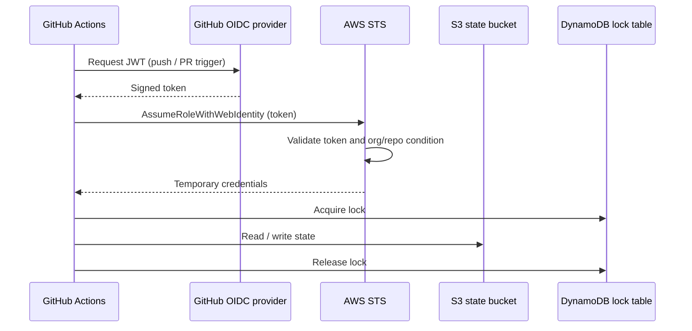
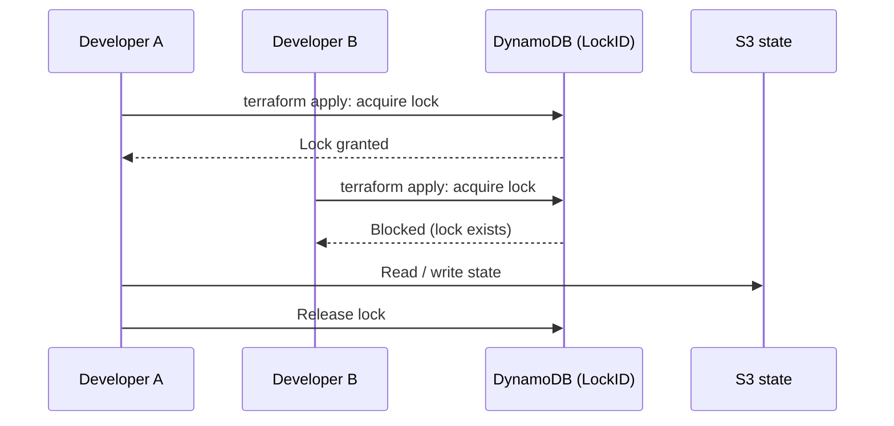

# Remote Terraform State Management on AWS

> A production-grade remote Terraform backend, provisioned with Terraform itself. It combines S3 storage, DynamoDB
> locking, KMS encryption, cross-region disaster recovery, audit logging and alerting, with keyless GitHub Actions
> authentication through OIDC.
---

## Overview

Terraform state is the **source of truth** for your infrastructure. By default it lives in a local `terraform.tfstate`
file, which is fine for learning but breaks down for teams. This project builds a secure remote backend that provides:

| Capability                        | Delivered by                                       |
|-----------------------------------|----------------------------------------------------|
| Shared, durable storage           | S3 bucket with versioning                          |
| Concurrency protection            | DynamoDB state locking                             |
| Encryption at rest and in transit | KMS customer-managed keys, TLS-only bucket policy  |
| Disaster recovery                 | S3 cross-region replication, DynamoDB global table |
| Auditability                      | CloudTrail data events, S3 access logs             |
| Monitoring and alerting           | CloudWatch alarms, SNS notifications               |
| Keyless CI/CD access              | GitHub OIDC identity provider and IAM role         |

**What you will learn**

- Local vs remote state, and why remote is the production default
- Bootstrapping the state infrastructure with Terraform
- State locking, encryption and access control
- Automated backup, replication and recovery
- Monitoring and auditing of the state bucket and lock table
- Migrating an existing local state to the remote backend

---

## Background: Terraform state

### What state is and does

Terraform state is a JSON file (`terraform.tfstate`) that:

- Maps your configuration (`.tf` files) to real-world resources
- Stores metadata such as resource IDs, attributes and dependencies
- Caches attribute values to improve performance

On every `terraform plan` or `apply`, Terraform compares the **desired state** (your code) with the **recorded state**
(this file) and the **actual infrastructure**, then calculates the create, update or delete actions required. After an
`apply`, it writes the new result back to the state file.

### State file structure

```json
{
  "version": 4,
  "terraform_version": "1.15.0",
  "serial": 42,
  "lineage": "a1b2c3d4-e5f6-7890-abcd-ef1234567890",
  "outputs": {
    "vpc_id": {
      "value": "vpc-0abc123def456",
      "type": "string"
    }
  },
  "resources": [
    {
      "mode": "managed",
      "type": "aws_vpc",
      "name": "main",
      "provider": "provider[registry.terraform.io/hashicorp/aws]",
      "instances": [
        {
          "schema_version": 1,
          "attributes": {
            "id": "vpc-0abc123def456",
            "cidr_block": "10.0.0.0/16",
            "tags": {
              "Name": "main-vpc",
              "Environment": "production"
            }
          },
          "sensitive_attributes": [],
          "dependencies": []
        }
      ]
    }
  ]
}
```

| Field               | Purpose                                        | Example         |
|---------------------|------------------------------------------------|-----------------|
| `version`           | State file format version                      | `4` (current)   |
| `terraform_version` | Terraform version that last modified the state | `1.15.0`        |
| `serial`            | Increments on every state change               | `42`            |
| `lineage`           | Unique ID for the state's lifecycle            | UUID            |
| `outputs`           | Output values from the configuration           | VPC ID, ALB DNS |
| `resources`         | Tracked infrastructure resources               | EC2, RDS, S3    |

### Why local state fails

| Problem                                        | Impact                                                                                                                     |
|------------------------------------------------|----------------------------------------------------------------------------------------------------------------------------|
| **No collaboration or single source of truth** | Developers hold different copies, apply conflicting changes and overwrite each other's work                                |
| **No locking**                                 | Concurrent applies can corrupt the state                                                                                   |
| **No backup or versioning**                    | A lost laptop means a lost infrastructure mapping, and there is no history to roll back to                                 |
| **No secure sharing**                          | The file often contains secrets in plaintext (API keys, passwords, private keys) and is easily committed to Git by mistake |

### Why remote state is the answer

A remote backend (Amazon S3 with DynamoDB, Azure Blob Storage, Google Cloud Storage, or HCP Terraform) gives you shared
access, locking, versioning, encryption at rest and high availability. For team or production use, **a remote backend is
a necessity, not an option**.

### Why access control and backups matter

**The state file can contain:** resource IDs and ARNs that map your infrastructure, database passwords and connection
strings, private keys (for example from `tls_private_key`), API keys passed through variables, and output values,
including those marked `sensitive`. Treat it as a secret.

**Without a recoverable state:**

- Terraform no longer knows what to create, update or destroy, and `plan` shows every resource as new
- Orphaned resources must be cleaned up manually
- A regional outage blocks every `plan` and `apply`
- Accidental deletion, a failed migration or a race condition can corrupt or erase the state
- A compromised storage account could allow state tampering

---

## Architecture


*A secure, keyless CI/CD pipeline that deploys Terraform from GitHub Actions to AWS.*

### Components

| Component                               | Role                                                                                  |
|-----------------------------------------|---------------------------------------------------------------------------------------|
| **GitHub / GitHub Actions**             | Hosts the Terraform code and triggers deployments                                     |
| **GitHub OIDC identity provider**       | Authenticates GitHub to AWS with short-lived JWT tokens, so no static keys are needed |
| **S3 source bucket** (`us-east-1`)      | Stores `terraform.tfstate`; versioned and encrypted                                   |
| **S3 destination bucket** (`us-west-2`) | Cross-region replication target for disaster recovery                                 |
| **IAM replication role**                | Assumed by the S3 service to replicate objects between buckets                        |
| **DynamoDB global table**               | Locks state across both regions to prevent concurrent modification                    |
| **KMS keys**                            | One per region and purpose; encrypt state, replica, audit logs and lock table         |
| **CloudTrail, CloudWatch, SNS**         | Audit, monitor and alert on all state activity                                        |

### Authentication and execution flow



### Why this pattern

| Benefit               | Detail                                                           |
|-----------------------|------------------------------------------------------------------|
| No static credentials | OIDC tokens are short-lived and scoped to a specific repository  |
| Shared state          | S3 gives the whole team one source of truth                      |
| Safe concurrency      | DynamoDB prevents state corruption                               |
| Auditability          | S3 versioning and CloudTrail keep a full history                 |
| Resilience            | Replication to a second region protects against regional failure |

This is considered best practice for running Terraform in a team or CI environment on AWS.

---

## Prerequisites

- [ ] An AWS account
- [ ] AWS CLI configured with sufficient permissions (see below)
- [ ] Terraform `>= 1.0` installed
- [ ] A GitHub repository for the code, with `github_org` and `github_repo` values available
- [ ] After the first apply: the GitHub OIDC provider and IAM role exist (created by the `iam` module), and the role ARN
  stored as a GitHub secret named `AWS_ROLE_ARN`

> **Note:** the `iam` module creates the OIDC provider itself (`aws_iam_openid_connect_provider`). If one already exists
> in your account for `token.actions.githubusercontent.com`, import it or reference it instead, because AWS allows only
> one per URL.

**Permissions required by the deploying identity**

| Service                            | Access                                    |
|------------------------------------|-------------------------------------------|
| S3, DynamoDB, KMS, SNS, CloudTrail | Full access                               |
| IAM                                | Create roles, policies and OIDC providers |
| CloudWatch                         | Logs, alarms, dashboards and metrics      |

---

## Design requirements

| Component               | Requirements                                                                                                                                                                                                                                                           |
|-------------------------|------------------------------------------------------------------------------------------------------------------------------------------------------------------------------------------------------------------------------------------------------------------------|
| **S3 state bucket**     | Deletion protection · versioning · KMS encryption (bucket key enabled) · all public access blocked (**critical**) · access logging · lifecycle policy for cost tiers · `ObjectCreated` / `ObjectRemoved` events to SNS · cross-region replication of encrypted objects |
| **DynamoDB lock table** | KMS encryption · deletion protection · point-in-time recovery · global table replica in the DR region                                                                                                                                                                  |
| **Security**            | Least-privilege IAM for state access · dedicated KMS keys with rotation · bucket policy enforcing TLS, KMS-encrypted uploads and MFA for deletes                                                                                                                       |
| **CloudTrail**          | Dedicated trail for state auditing · data events for the state bucket and lock table · own audit bucket with retention policy · log file validation · events forwarded to CloudWatch Logs                                                                              |
| **CloudWatch**          | Alarms for state modification, unusual access, stale locks, stale backups, replication lag, OIDC failures and root account usage (details in [CloudWatch module](#module-cloudwatch))                                                                                  |
| **SNS**                 | Topics and email subscriptions for state alerts and S3 events                                                                                                                                                                                                          |

---

## Implementation

### Project structure

```
remote-backend-setup/
└── modules/
    ├── cloudtrail/            # Audit logging infrastructure
    ├── cloudwatch/            # Monitoring and alerting
    ├── dynamodb/              # State lock table (global table)
    ├── iam/
    │   ├── bucket_policy.tf   # State bucket security policy
    │   ├── github_actions.tf  # GitHub OIDC provider and role
    │   ├── iam_cloudtrail.tf  # CloudTrail permissions and audit bucket policy
    │   ├── iam_replication.tf # S3 cross-region replication role
    │   └── main.tf
    ├── kms/                   # Encryption keys (both regions)
    ├── s3/
    │   ├── s3-state-file.tf   # State bucket, logging, lifecycle, events
    │   └── replication.tf     # DR replica bucket
    └── sns/                   # Alert topics and subscriptions
        # Each module also contains main.tf (where not listed), outputs.tf and variables.tf
```

### How the modules connect

| Module       | Consumes                           | Provides                                                           |
|--------------|------------------------------------|--------------------------------------------------------------------|
| `kms`        | IAM execution role ARN             | State, replica, CloudTrail and DynamoDB-replica keys               |
| `iam`        | S3, CloudTrail and CloudWatch ARNs | Execution role, replication role, CloudTrail role, bucket policies |
| `dynamodb`   | KMS keys                           | Lock table name and ID                                             |
| `s3`         | KMS keys, replication role         | State and replica bucket ARNs and IDs                              |
| `sns`        | State bucket ARN                   | Alert topic ARN                                                    |
| `cloudtrail` | S3, DynamoDB, KMS, IAM, log group  | Audit trail and bucket                                             |
| `cloudwatch` | S3, DynamoDB, SNS                  | Log group, alarms, metric filters                                  |

### Module `iam`

```hcl
module "iam" {
  source = "./modules/iam"

  current_region     = data.aws_region.current.region
  current_account_id = data.aws_caller_identity.current.account_id
  github_org         = var.github_org
  github_repo        = var.github_repo
  environment        = var.environment
  project_name       = var.project_name
  naming_prefix      = local.naming_prefix
  common_tags        = local.common_tags

  bucket_cloudtrail_logs_bucket   = module.cloudtrail.bucket.cloudtrail_logs.bucket
  bucket_cloudtrail_logs_id       = module.cloudtrail.bucket.cloudtrail_logs_id
  bucket_state_backup_replica_arn = module.s3.bucket_state_backup_replica_arn
  bucket_terraform_state_arn      = module.s3.bucket_terraform_state_arn
  bucket_terraform_state_id       = module.s3.bucket_terraform_state_id
  terraform_state_log_group_arn   = module.cloudwatch.terraform_state_log_group_arn
}
```

**`bucket_policy.tf`**: secures the state bucket with four statements, a defense-in-depth pattern in which no single
misconfiguration can expose the state.

| Statement                      | Effect                         | Purpose                                 |
|--------------------------------|--------------------------------|-----------------------------------------|
| `DenyInsecureTransport`        | Blocks HTTP requests           | Encryption in transit                   |
| `DenyUnencryptedObjectUploads` | Blocks non-KMS uploads         | Encryption at rest                      |
| `EnforceMFAForDelete`          | Blocks deletes without MFA     | Protects state from deletion            |
| `AllowTerraformRoleAccess`     | Allows the GitHub Actions role | CI/CD access without static credentials |

**`github_actions.tf`**: configures keyless GitHub-to-AWS authentication.

1. `aws_iam_openid_connect_provider`: trusts GitHub as an identity provider
2. `aws_iam_role`: the role GitHub Actions assumes, restricted by an org/repo condition
3. `aws_iam_role_policy_attachment`: attaches the permission policy

No AWS keys are ever stored in GitHub; credentials are ephemeral and tied to one repository.

**`iam_cloudtrail.tf`**: gives CloudTrail what it needs to deliver logs.

- `aws_iam_role.cloudtrail_logs`: assumable only by `cloudtrail.amazonaws.com`
- `aws_iam_role_policy.cloudtrail_logs_policy`: least privilege, limited to `logs:CreateLogStream` and
  `logs:PutLogEvents`
- `aws_s3_bucket_policy.cloudtrail_audit_logs`: `AWSCloudTrailAclCheck` (read the bucket ACL) and `AWSCloudTrailWrite`
  (write under `AWSLogs/<account-id>/`, bucket-owner only). Both are locked to one trail through an `aws:SourceArn`
  condition.

```
CloudTrail trail
  ├── S3 audit bucket   (bucket policy: long-term storage)
  └── CloudWatch Logs   (IAM role: real-time monitoring)
```

**`iam_replication.tf`**: lets S3 replicate objects across regions.

- `aws_iam_role.replication`: assumable only by `s3.amazonaws.com`
- `aws_iam_role_policy.replication` with three permission groups: (1) read source bucket configuration and list objects,
  (2) read object content, metadata, tags and versions, (3) write, delete and sync tags in the replica bucket

### Module `kms`

```hcl
module "kms" {
  source = "./modules/kms"

  current_account_id               = data.aws_caller_identity.current.account_id
  naming_prefix                    = local.naming_prefix
  common_tags                      = local.common_tags
  iam_role_terraform_execution_arn = module.iam.iam_role_terraform_execution_arn
}
```

KMS keys are region-scoped, so four keys are created across two regions. All have `enable_key_rotation = true`.

| Key                                 | Region      | Purpose                                           |
|-------------------------------------|-------------|---------------------------------------------------|
| `aws_kms_key.terraform_state`       | `us-east-1` | Encrypts the state bucket                         |
| `aws_kms_key.cloudtrail`            | `us-east-1` | Encrypts CloudTrail audit logs                    |
| `aws_kms_key.replication_state_key` | `us-west-2` | Required by S3 replication to encrypt the replica |
| `aws_kms_key.dynamodb_replica`      | `us-west-2` | Encrypts the DynamoDB global table replica        |

### Module `dynamodb`

```hcl
module "dynamodb" {
  source = "./modules/dynamodb"

  current_account_id           = data.aws_caller_identity.current.account_id
  naming_prefix                = local.naming_prefix
  common_tags                  = local.common_tags
  dynamodb_replica_kms_key_arn = module.kms.dynamodb_replica_kms_key_arn
  secondary_region             = var.secondary_region
  terraform_state_kms_key_arn  = module.kms.terraform_state_kms_key_arn
}
```

The table acts as a **distributed lock**: Terraform writes a lock entry before changing state and removes it afterwards,
so two concurrent runs cannot overwrite each other.



| Feature                               | Detail                                                                       |
|---------------------------------------|------------------------------------------------------------------------------|
| `billing_mode = PAY_PER_REQUEST`      | No capacity planning; scales automatically                                   |
| `LockID` primary key                  | Terraform writes `<bucket>/<path>/terraform.tfstate`                         |
| Streams (`NEW_AND_OLD_IMAGES`)        | Required for global tables; captures before and after images for replication |
| Point-in-time recovery                | Restore to any second in the last 35 days                                    |
| `lifecycle.prevent_destroy = true`    | Terraform refuses to destroy the table                                       |
| Encryption (customer-managed KMS key) | Full control over key rotation                                               |
| Global table replica                  | Secondary region, each side with its own KMS key                             |

### Module `s3`

```hcl
module "s3" {
  source = "./modules/s3"

  current_account_id                = data.aws_caller_identity.current.account_id
  naming_prefix                     = local.naming_prefix
  common_tags                       = local.common_tags
  secondary_region                  = var.secondary_region
  terraform_state_kms_key_arn       = module.kms.terraform_state_kms_key_arn
  environment                       = var.environment
  iam_role_replication_arn          = module.iam.iam_role_replication_arn
  replication_state_key_kms_key_arn = module.kms.replication_state_key_kms_key_arn
}
```

**`s3-state-file.tf`**: the primary state bucket and its protections.

| Resource                                             | Purpose                                                  |
|------------------------------------------------------|----------------------------------------------------------|
| `random_string`                                      | 8-character suffix for a globally unique bucket name     |
| `aws_s3_bucket.terraform_state`                      | Primary bucket for `.tfstate` files                      |
| `aws_s3_bucket_versioning`                           | Recover previous state versions                          |
| `aws_s3_bucket_server_side_encryption_configuration` | KMS encryption; `bucket_key_enabled = true` reduces cost |
| `aws_s3_bucket_public_access_block`                  | Blocks all public access                                 |
| `aws_s3_bucket_lifecycle_configuration`              | Automatic storage class transitions (below)              |
| `aws_s3_bucket.access_logs`                          | Dedicated access-log bucket, expires after 90 days       |
| `aws_s3_bucket_logging`                              | Ships logs under `terraform-state-access-logs/`          |
| `aws_s3_bucket_notification`                         | Publishes `*.tfstate` create and delete events to SNS    |

| Lifecycle transition          | Storage class  |
|-------------------------------|----------------|
| After `var.standard_ia` days  | `STANDARD_IA`  |
| After `var.glacier_ir` days   | `GLACIER_IR`   |
| After `var.deep_archive` days | `DEEP_ARCHIVE` |

```
S3 state bucket ── KMS encryption · versioning · public access blocked · lifecycle tiers
  ├── Access logs   ──► Logs bucket (90-day expiry)
  └── Object events ──► SNS topic (alerts / automation)
```

**`replication.tf`**: cross-region disaster recovery.

| Primary (`us-east-1`)                               | Replica (`us-west-2`)                                                                       |
|-----------------------------------------------------|---------------------------------------------------------------------------------------------|
| `terraform_state` bucket (KMS encrypted, versioned) | `state_backup_replica` bucket (re-encrypted with the replica key, `STANDARD_IA`, versioned) |

Replication uses the rule ID `replicate-all-state`, which the CloudWatch lag alarm monitors.

### Module `sns`

```hcl
module "sns" {
  source = "./modules/sns"

  current_account_id         = data.aws_caller_identity.current.account_id
  naming_prefix              = local.naming_prefix
  common_tags                = local.common_tags
  bucket_terraform_state_arn = module.s3.bucket_terraform_state_arn
  current_region             = data.aws_region.current.region
  email_subscriptions        = var.email_subscriptions
}
```

| Resource                                        | Purpose                                                    |
|-------------------------------------------------|------------------------------------------------------------|
| `aws_sns_topic.terraform_state_alerts`          | General alerts for Terraform state events                  |
| `aws_sns_topic.s3_event_notification_topic`     | S3 object events; its resource policy allows S3 to publish |
| `aws_sns_topic_subscription.state_backup_email` | One email subscription per topic and address               |

```
S3 state bucket ──► s3-event-notification-topic ──► email subscribers
CloudWatch alarms ─► terraform-state-alerts      ──► email subscribers
```

> Subscribers must **confirm** the subscription email before they receive alerts.

### Module `cloudtrail`

```hcl
module "cloudtrail" {
  source = "./modules/cloudtrail"

  current_account_id                  = data.aws_caller_identity.current.account_id
  naming_prefix                       = local.naming_prefix
  common_tags                         = local.common_tags
  bucket_terraform_state_arn          = module.s3.bucket_terraform_state_arn
  current_region                      = data.aws_region.current.region
  bucket_policy_cloudtrail_audit_logs = module.iam.bucket_policy_cloudtrail_audit_logs
  cloudtrail_kms_key_arn              = module.kms.cloudtrail_kms_key_arn
  dynamodb_table_name                 = module.dynamodb.dynamodb_table_name
  iam_role_cloudtrail_logs_arn        = module.iam.iam_role_cloudtrail_logs_arn
  terraform_state_log_group_arn       = module.cloudwatch.terraform_state_log_group_arn
}
```

**Resources:** an audit bucket (`<prefix>-terraform-audit-logs`) that is versioned (tamper evidence), KMS-encrypted,
fully public-blocked and lifecycle-managed, plus the `aws_cloudtrail` trail.

**Trail settings**

- `enable_log_file_validation = true`: cryptographic digests to detect tampering
- `include_global_service_events = true`: captures IAM, STS and CloudFront events
- `is_multi_region_trail = true`: one trail covers all regions
- Streams to CloudWatch Logs for real-time querying and alerting
- `depends_on` the bucket policy, so the trail is created only once the bucket is ready

**Event selectors (what is recorded)**

- **S3 data events**: every `GetObject`, `PutObject` and `DeleteObject` on the state bucket
- **DynamoDB data events**: every read and write on the lock table (lock acquisition and release)

**Audit log retention**

| Action                                | After                                        |
|---------------------------------------|----------------------------------------------|
| Clean up incomplete multipart uploads | 7 days                                       |
| Delete non-current object versions    | 30 days                                      |
| Move to Glacier                       | 90 days                                      |
| Permanently delete logs               | 365 days (adjust to compliance requirements) |

```
terraform plan / apply
  ├── S3 state bucket
  └── DynamoDB lock table
         │ every access emits an event
         ▼
   CloudTrail trail ──► S3 audit bucket (encrypted, 365 days)
         └───────────► CloudWatch Logs (real-time alerts)
```

**What to audit**

| Dimension | Question answered                                |
|-----------|--------------------------------------------------|
| **Who**   | User identity, CI/CD pipeline or service account |
| **When**  | Timestamp of the change                          |
| **What**  | Resources added, modified or removed             |
| **How**   | Manual apply, pipeline run or state push         |
| **Why**   | Linked PR, ticket or change request              |

### Module `cloudwatch`

```hcl
module "cloudwatch" {
  source = "./modules/cloudwatch"

  naming_prefix                     = local.naming_prefix
  common_tags                       = local.common_tags
  bucket_state_backup_replica_id    = module.s3.bucket_state_backup_replica_id
  bucket_terraform_state_id         = module.s3.bucket_terraform_state_id
  dynamodb_table_name               = module.dynamodb.dynamodb_table_name
  dynamodb_table_terraform_locks_id = module.dynamodb.dynamodb_table_terraform_locks_id
  secondary_region                  = var.secondary_region
  sns_terraform_state_alerts_arn    = module.sns.sns.terraform_state_alerts_arn
}
```

The module creates the log group that receives CloudTrail events (7-day retention) and the alarms below. **All alarms
notify the same SNS topic**, giving one place to watch.

| Category    | Alarm / filter           | Trigger                                                                    | Purpose                                                   |
|-------------|--------------------------|----------------------------------------------------------------------------|-----------------------------------------------------------|
| State file  | `state_modification`     | Any `PutObject` on the state bucket (threshold 0)                          | Audit every change                                        |
| State file  | `state_access`           | 5 or more accesses in 5 minutes                                            | Detect runaway processes or unauthorized access           |
| State file  | `excessive_state_access` | 100 or more accesses in 5 minutes                                          | Higher-severity security alarm                            |
| State file  | `state_backup_stale`     | Daily check finds fewer than 1 object                                      | Detect versioning or backup failure                       |
| Lock table  | `long_held_lock_alarm`   | `ItemCount > 1` for 1 hour (12 × 5-minute periods)                         | Detect ghost locks from crashed runs                      |
| Lock table  | `replication_latency`    | Global table replication above 5 seconds                                   | Detect cross-region lock inconsistency                    |
| Replication | `replication_lag`        | S3 replication latency above 15 minutes for 2 consecutive 5-minute windows | Detect a stale DR replica                                 |
| Security    | `oidc_failures`          | `AssumeRoleWithWebIdentity` with any `errorCode`, more than 5 in 5 minutes | Detect failed GitHub Actions authentication               |
| Security    | `unauthorized_api_calls` | `*UnauthorizedAccess` or `AccessDenied*`, more than 10 in 5 minutes        | Detect probing or misconfigured permissions               |
| Security    | `root_account_usage`     | `userIdentity.type = "Root"`, 1 or more in 5 minutes                       | **Zero tolerance**: any root use is an immediate red flag |

---

## Deployment

### CI/CD workflows

| Workflow              | Purpose                                                                 |
|-----------------------|-------------------------------------------------------------------------|
| `checkov.yml`         | Checkov security scan of Terraform at repository and PR level           |
| `tflint.yml`          | TFLint for style errors, security issues and provider-specific problems |
| `tfsec-scanner.yml`   | tfsec misconfiguration checks before changes reach the cloud            |
| `terrascan.yml`       | Terrascan vulnerability scan                                            |
| `infracost.yml`       | Cost estimate before deploying                                          |
| `backend.yml`         | Deploys the remote state backend using OIDC                             |
| `drift-detection.yml` | Scheduled drift checks that alert on unauthorized changes               |

### Deploy the backend

```bash
terraform init
terraform plan  -var-file="dev-terraform.tfvars"
terraform apply -var-file="dev-terraform.tfvars"
```

### Outputs

After a successful apply you receive a ready-to-use backend configuration and the execution role ARN (store the latter
as the `AWS_ROLE_ARN` GitHub secret).

```hcl
Apply complete! Resources : 0 added, 14 changed, 0 destroyed.

Outputs :

backend_config = <<EOT
terraform {
  backend "s3" {
    bucket         = "ce-dev-terraform-state-5bhkr8k3"
    key            = "dev/infrastructure/terraform.tfstate"
    region         = "us-east-1"
    encrypt        = true
    kms_key_id     = "<kms-key-id>"
    dynamodb_table = "ce-dev-terraform-locks"
  }
}
EOT

terraform_execution_role_arn = "arn:aws:iam::123456789012:role/ce-dev-github-actions-role"
```

> **Note on locking:** the configuration above uses DynamoDB, as designed in this project. Terraform 1.10+ also supports
> native S3 locking (`use_lockfile = true`), and the `dynamodb_table` argument is deprecated in recent versions. Check
> the
> version you pin before adopting either approach.

---

## Migrating from local to remote state

The backend is created with a **local** state first (bootstrap), then that state is moved into the backend it just
created.

1. **Deploy the backend infrastructure** (see [Deployment](#deploy-the-backend)).

2. **Save the outputs:**

   ```bash
   terraform output -json > backend-config.json
   terraform output -raw backend_config > backend.tf
   ```

3. **Back up the local state:**

   ```bash
   cp terraform.tfstate terraform.tfstate.backup
   ```

4. **Activate the backend** by committing `backend.tf` (the generated `backend "s3"` block).

5. **Migrate:**

   ```bash
   terraform init -migrate-state
   ```

   ```
   Do you want to copy existing state to the new backend?
   Pre-existing state was found while migrating the previous "local" backend to
   the newly configured "s3" backend. No existing state was found in the newly
   configured "s3" backend. Do you want to copy this state to the new "s3" backend?

   Enter a value: yes

   Successfully configured the backend "s3"!
   ```

6. **Verify, then clean up:**

   ```bash
   terraform state list                                              # resources are listed from remote state
   terraform show                                                    # backend is in use
   aws s3 ls s3://ce-dev-terraform-state-5bhkr8k3/dev/infrastructure/   # shows terraform.tfstate
   terraform plan                                                    # expect no changes

   # Only after everything checks out:
   rm terraform.tfstate terraform.tfstate.backup
   ```

---

## Operations

### State management commands

```bash
terraform state list                              # list all resources in state
terraform state show aws_instance.web             # inspect one resource
terraform state pull > state.json                 # download remote state for inspection
terraform state mv aws_instance.old aws_instance.new   # rename a resource in state
terraform state rm aws_instance.web               # stop tracking (resource still exists in the cloud)
```

### Disaster recovery and failover

- Keep a **backend configuration for each region** ready, so failover is a single change
- The DynamoDB global table keeps locking available in the DR region
- Store the failover runbook somewhere reachable during an outage, not only in the primary region
- Rehearse restores and failovers on a schedule (weekly or monthly)
- Watch `replication_lag` and `replication_latency`: stale replicas mean data loss at failover

---

## Best practices

**Security**

- Encrypt state at rest (KMS) and in transit (TLS-only bucket policy)
- Restrict state read and write access with least-privilege IAM
- Block all public access to the state bucket
- Use OIDC rather than long-lived access keys for CI/CD
- Never commit state or `.tfvars` containing secrets to Git

**Reliability and recovery**

- Enable versioning on the state bucket: the bare minimum and first line of defense against deletion and corruption
- Replicate state cross-region, and replicate the lock table too (DynamoDB global tables)
- Never keep backups in the same location as the primary state
- Retain backups for at least 30 days, since some problems surface late
- **Test restores regularly**: a backup you have never tested cannot be trusted

**Monitoring and audit**

- Enable CloudTrail data events for the state bucket and lock table
- Alarm on state modification, unusual access, long-held locks, stale backups and replication lag
- Alert on failed OIDC authentications and any root account use

**Operations**

- Keep this backend in its own project and state, separate from application infrastructure
- Use `prevent_destroy` on the state bucket and lock table
- Run drift detection and security scans (Checkov, tfsec, TFLint, Terrascan) on every PR

---

## Verification

After deployment, confirm the resources in the AWS Management Console.

| #  | Check                           | Screenshot                                                                                                     |
|----|---------------------------------|----------------------------------------------------------------------------------------------------------------|
| 1  | Terraform state migrated        |                              |
| 2  | S3 buckets created              |                                                   |
| 3  | State bucket properties         |                                             |
| 4  | Replica bucket properties       |                                 |
| 5  | State replicated to `us-west-2` |                            |
| 6  | DynamoDB table (primary)        |                            |
| 7  | DynamoDB table items            |  |
| 8  | DynamoDB table (secondary)      |                     |
| 9  | DynamoDB global table replicas  |                                 |
| 10 | KMS key (primary)               |                                                   |
| 11 | KMS key (secondary)             |                                         |
| 12 | KMS key rotation                |                                       |
| 13 | SNS topic                       |                                                   |
| 14 | SNS subscriptions               |                              |
| 15 | CloudTrail audit bucket         |                                         |
| 16 | CloudTrail trail details        |                                                   |
| 17 | CloudWatch log groups           |                                    |
| 18 | CloudTrail log group details    |      |
| 19 | CloudWatch alarms               |                                              |

---

## Cleaning up

The state bucket and lock table are protected by `prevent_destroy`, so teardown is deliberately a manual, multi-step
process:

1. Migrate state back to local (remove the `backend` block, then `terraform init -migrate-state`)
2. Remove or disable `prevent_destroy` and any deletion protection on the protected resources
3. Destroy:

```bash
terraform destroy -var-file="dev-terraform.tfvars"
```

> Review the plan before confirming. Use `-auto-approve` only in disposable environments, since this stack holds the
> state of other infrastructure.

---

## Conclusion

Remote state is foundational for production Terraform, so set it up correctly from the start. This project combines:

- **S3** for durable storage
- **KMS encryption** for security
- **Versioning and replication** for recovery
- **DynamoDB** for locking
- **CloudTrail, CloudWatch and SNS** for visibility
- **OIDC** for credential-free automation

The result is a production-ready state management system for team collaboration. Treat state files as sensitive data,
control access through IAM, and rely on versioning when you need to troubleshoot or roll back.

---

*Project by Darvin | Remote Terraform State Management*