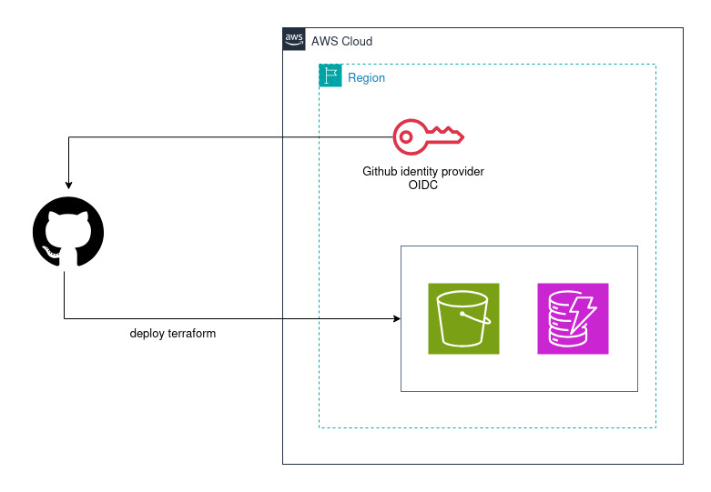

# Setting Up Remote Terraform Backend using Terraform

> This project demonstrates how to design and implement a production-grade **Remote Terraform State Management** using Terraform, with security as a first-class concern for team collaboration, state locking, and disaster recovery.

Terraform state is the **source of truth** for your infrastructure. By default, it lives in a local `terraform.tfstate` file, which works for learning but fails for teams. Remote state solves collaboration, security, and reliability problems.

---

## Table of Contents

-   [What is Terraform State?](#what-is-terraform-state)
    -   [State File Structure](#state-file-structure)
    -   [What is the terraform.tfstate File?](#what-is-the-terraformtfstate-file)
    -   [Critical State File Components](#critical-state-file-components)
-   [Problems with Local State File](#problems-with-local-state-file)
-   [Why Remote State is Recommended](#why-remote-state-is-recommended)
-   [Learning Objectives](#learning-objectives)
-   [Why Remote State Matters](#why-remote-state-matters)
-   [Architecture Overview](#architecture-overview)
    -   [Architecture Details](#architecture-details)
    -   [Flow](#flow)
    -   [Why This Pattern?](#why-this-pattern)
-   [Prerequisites](#prerequisites)
    -   [Required AWS Permissions](#required-aws-permissions)
-   [Specification](#specification)
-   [Why State Access Matters](#why-state-access-matters)
-   [Why State Backups Matter](#why-state-backups-matter)
-   [Audit Terraform State Changes](#audit-terraform-state-changes)
-   [Best Practices](#best-practices)
-   [Implementation](#implementation)
    -   [Project Structure](#project-structure)
    -   [Module IAM](#module-iam)
    -   [Module KMS](#module-kms)
    -   [Module DynamoDB](#module-dynamodb)
    -   [Module S3](#module-s3)
    -   [Module SNS](#module-sns)
    -   [Module CloudTrail](#module-cloudtrail)
    -   [Module CloudWatch](#module-cloudwatch)
-   [Outputs](#outputs)
-   [Migrating from Local to Remote State](#migrating-from-local-to-remote-state)
-   [State Management Commands](#state-management-commands)
-   [Deployment Workflow](#deployment-workflow)
-   [Verification](#verification)
-   [Cleaning Up](#cleaning-up)
-   [Conclusion](#conclusion)

---

## What is Terraform State?

Terraform state is a JSON file that:

-   Maps your configuration code to real-world resources
-   Stores metadata about resource dependencies
-   Caches attribute values to improve performance

Every time you run `terraform apply`, Terraform compares this state file against your desired configuration and actual AWS resources to calculate what changes need to be made.

### State File Structure

```json
{
    "version": 4,
    "terraform_version": "1.15.0",
    "serial": 42,
    "lineage": "a1b2c3d4-e5f6-7890-abcd-ef1234567890",
    "outputs": {
        "vpc_id": {
            "value": "vpc-0abc123def456",
            "type": "string"
        }
    },
    "resources": [
        {
            "mode": "managed",
            "type": "aws_vpc",
            "name": "main",
            "provider": "provider[registry.terraform.io/hashicorp/aws]",
            "instances": [
                {
                    "schema_version": 1,
                    "attributes": {
                        "id": "vpc-0abc123def456",
                        "cidr_block": "10.0.0.0/16",
                        "enable_dns_hostnames": true,
                        "enable_dns_support": true,
                        "arn": "arn:aws:ec2:us-east-1:123456789012:vpc/vpc-0abc123def456",
                        "tags": {
                            "Name": "main-vpc",
                            "Environment": "production"
                        }
                    },
                    "sensitive_attributes": [],
                    "private": "eyjzY2hlbWFfdmVyc2lvbiI6IjEifQ==",
                    "dependencies": []
                }
            ]
        }
    ]
}

```

### What is the terraform.tfstate File?

If you've worked with Terraform before and created some resources, you might have noticed that after running `terraform init`, a file named `terraform.tfstate` is automatically generated. This file is the **heart** of your Terraform project.

**But what exactly does it do?**

The `terraform.tfstate` file maintains a mapping between the infrastructure code written in your `.tf` files and the actual resources deployed in your cloud account. It stores the last known state of those resources, including important metadata like resource IDs, attributes, dependencies, and more.

**Here's why this is so important:**

-   When you run `terraform plan`, Terraform reads this file to compare the **desired state** (what's in your code) with the **actual state** (what's currently running in your cloud).
-   It then shows you the differences and determines what actions (create, update, delete) are needed to bring the infrastructure in sync with your code.
-   When you run `terraform apply`, Terraform updates the actual infrastructure and then updates the `terraform.tfstate` file accordingly.

In short, this file is what allows Terraform to track, manage, and orchestrate changes to your infrastructure consistently and reliably.

### Critical State File Components

| Component | Purpose | Example |
| --- | --- | --- |
| `version` | State file format version | 4 (current) |
| `terraform_version` | Terraform version that last modified state | 1.15.0 |
| `serial` | Increments with each state change | 42 |
| `lineage` | Unique ID for state file lifecycle | UUID |
| `outputs` | Output values from configuration | VPC ID, ALB DNS |
| `resources` | Tracked infrastructure resources | EC2, RDS, S3 |

---

## Problems with Local State File

While the `terraform.tfstate` file plays a critical role in managing your infrastructure, storing it locally comes with serious drawbacks — especially in team environments or production setups.

### 1\. Sensitive Information Exposure

The state file often contains sensitive data like:

-   API keys
-   Passwords
-   Resource metadata and configuration values

If this file is stored locally and shared improperly (e.g., committed to Git), it can lead to security risks and potential breaches.

### 2\. No Single Source of Truth

Let's say two developers are working on the same Terraform project with local state files. If both of them:

-   Make changes
-   Apply them independently
-   And have different versions of the `terraform.tfstate` file

...this can lead to conflicting updates, resource mismatches, or worse — an endless loop of undoing each other's changes. The result? **Chaos and an unreliable infrastructure state.**

### 3\. Lack of Collaboration and Control

Local state doesn't support features like:

-   **State Locking:** Prevents multiple users from making concurrent changes
-   **Versioning:** Track history of infrastructure changes
-   **Secure Sharing:** Centralized access for teams
-   **High Availability:** No risk of losing state due to a lost local machine

---

## Why Remote State is Recommended

To address these issues, Terraform allows storing state remotely using backends like:

-   **Amazon S3** (with DynamoDB for state locking)
-   **Azure Blob Storage**
-   **Google Cloud Storage**
-   **HashiCorp Cloud Platform (HCP) Terraform**

Remote backends provide:

-   ✅ Encrypted storage
-   ✅ Automatic versioning
-   ✅ Team-friendly collaboration
-   ✅ State locking to avoid simultaneous updates

> For most real-world projects — especially when working in a team or managing production infrastructure — configuring a remote backend is not just a best practice, **it's a necessity.**

---

## Learning Objectives

By completing this project, you will learn:

-   ✔️ Understanding Managing Terraform State File: Local vs Remote
-   ✔️ Configuring Backend Resource Creation
-   ✔️ Bootstrap — Creating State Infrastructure
-   ✔️ State Locking with DynamoDB
-   ✔️ State File Security and Access Control
-   ✔️ Monitor S3 bucket of Terraform State File and Lock Table
-   ✔️ Deploy State Infrastructure
-   ✔️ Securely Manage Terraform State Files
-   ✔️ State File Backup and Recovery — Automated Backup Strategy
-   ✔️ Migrating from Local to Remote State

---

## Why Remote State Matters

**Local state has serious limitations:**

| Problem | Impact |
| --- | --- |
| ❌ No collaboration | Team members overwrite each other's changes |
| ❌ No locking | Concurrent applies corrupt state |
| ❌ No backup | Laptop crashes lose infrastructure mapping |
| ❌ No security | State contains sensitive values in plaintext |

**Remote state provides:**

| Benefit | Detail |
| --- | --- |
| ✅ Shared access | Teams work from the same state |
| ✅ Locking | Prevent concurrent modifications |
| ✅ Versioning | Roll back to previous states |
| ✅ Encryption | Protect sensitive data at rest |

---

## Architecture Overview

**Remote Terraform State Architecture with GitHub OIDC**

This diagram shows a secure, keyless CI/CD pipeline for deploying Terraform from GitHub Actions to AWS.



### Architecture Details

| Component | Role |
| --- | --- |
| **GitHub** | Source of truth — Terraform code lives here; GitHub Actions triggers deployments |
| **GitHub OIDC Identity Provider** | Authenticates GitHub to AWS via short-lived JWT tokens — no static keys needed |
| **S3 Source Bucket** (`us-east-1`) | Stores `terraform.tfstate` remotely; enables team collaboration, locking, and versioning |
| **S3 Destination Bucket** (`us-west-2`) | Cross-region replication target for disaster recovery |
| **S3 Service / IAM Role** | Assumes the role to encrypt and decrypt both S3 buckets |
| **DynamoDB Global Table** | Handles state locking across both regions to prevent concurrent state corruption |

### Flow

1.  A push/PR triggers a GitHub Actions workflow
2.  The runner requests an OIDC token from GitHub
3.  AWS validates the token against the registered GitHub identity provider
4.  The runner assumes an IAM role (**no static credentials!**)
5.  Terraform accesses the S3 backend to read/write state
6.  DynamoDB locks the state during the operation

```
GitHub Actions workflow
  └── Requests JWT token from GitHub OIDC
        └── https://token.actions.githubusercontent.com
              └── Presents token to AWS STS
                    └── AWS validates token → Checks org/repo condition
                          └── Issues temporary credentials
                                └── GitHub Actions assumes IAM Role
                                      └── Runs Terraform

```

### Why This Pattern?

| Benefit | Detail |
| --- | --- |
| No static credentials | OIDC tokens are short-lived and scoped |
| Shared state | S3 enables team collaboration |
| Safe concurrency | DynamoDB prevents state corruption |
| Auditability | S3 versioning keeps state history |

> ✅ This is considered the **best practice** for managing Terraform in a team/CI environment on AWS.

---

## Prerequisites

Before starting, ensure you have the following:

-   [ ]  AWS account
-   [ ]  AWS CLI configured with appropriate permissions
-   [ ]  Terraform `>= 1.0` installed
-   [ ]  Create an OpenID Connect identity provider in Amazon IAM that has a trust relationship with your GitHub repository
-   [ ]  Store the ARN of the IAM Role as a GitHub secret named `AWS_ROLE_ARN`, referenced in the workflow files

### Required AWS Permissions

Your AWS user/role needs permissions for:

| Service | Access Level |
| --- | --- |
| S3 | Full access |
| DynamoDB | Full access |
| KMS | Full access |
| SNS | Full access |
| CloudTrail | Full access |
| CloudWatch | Dashboard and metrics access |

---

## Technical Specification

### S3 Bucket for State Files

-   🔒 Prevent accidental deletion
-   📜 Enable versioning to keep state history
-   🔐 Enable encryption
-   🚫 Block all public access (**CRITICAL SECURITY**)
-   📋 Enable access logging on the state bucket
-   💰 S3 bucket lifecycle policy for cost optimization
-   📣 S3 events to SNS notifications for `ObjectCreated` and `ObjectRemoved`
-   🌍 S3 replication for disaster recovery (cross-region state backup)
-   🔁 Replicate encrypted objects

### DynamoDB Table for State Locking

-   🔐 Enable encryption
-   🔒 Prevent accidental deletion
-   🌍 Enable global table replication to the DR region

### Security

-   🛡️ IAM policies for state access
-   🔑 KMS key for state encryption
-   🏰 Bucket policy for defense-in-depth: enforce encryption in transit

### SNS Topic for Notifications/Alerts on Terraform State

### CloudTrail for API-Level Auditing

-   🗂️ S3 bucket for audit logs with its own retention policy
-   🔍 CloudTrail trail specifically for Terraform state auditing
-   📸 Capture data events for the state bucket
-   🔒 Capture DynamoDB events for lock operations
-   📡 Centralize audit logs: send CloudTrail events to CloudWatch Logs

### CloudWatch Log Group for Terraform State

Set up CloudWatch alerts on Terraform state:

-   ⏱️ Alert when Terraform locks are held too long
-   👀 Alert when unusual Terraform state access detected
-   ✏️ Alert when Terraform state is modified
-   🔐 Alert on state file access
-   ⚠️ Alert when more than 5 accesses over a 5-minute period
-   🕒 Alert when state backups are stale
-   📡 Alert when Terraform state replication is lagging
-   🚨 Multiple failed OIDC authentication attempts detected
-   🔴 Security alerts

---

## Why State Access Matters

The state file contains things you would **not** want exposed:

-   Resource IDs and ARNs that map your infrastructure
-   Database passwords and connection strings
-   Private keys generated by the `tls_private_key` resource
-   API keys passed to resources via variables
-   Output values, including any marked as `sensitive`

---

## Why State Backups Matter

Without disaster recovery for Terraform state:

-   ❌ Terraform cannot determine what needs to be created, updated, or destroyed
-   ❌ Running `terraform plan` will show every resource as "new"
-   ❌ Manual cleanup of orphaned resources becomes necessary
-   ❌ Sensitive outputs and resource attributes are lost
-   ❌ A regional cloud outage makes your state inaccessible — you cannot run `terraform plan` or `terraform apply`
-   ❌ Accidental deletion of the state file orphans all managed resources
-   ❌ State corruption from a failed migration or race condition blocks all operations
-   ❌ A compromised storage account could lead to state tampering

---

## Audit Terraform State Changes

When something goes wrong with your infrastructure, one of the first questions is **"what changed?"** Auditing Terraform state changes gives you a clear trail of who modified what and when. This is critical for:

-   Compliance in regulated industries
-   Debugging production issues
-   Security monitoring

### What to Audit

| Dimension | Question |
| --- | --- |
| **Who** | User identity, CI/CD pipeline, service account |
| **When** | Timestamp of the change |
| **What** | Resources added, modified, or removed |
| **How** | Manual apply, CI/CD pipeline, state push |
| **Why** | Linked PR, ticket, or change request |

---

## Best Practices

-   🔐 **Enable encryption** — Always encrypt state at rest
-   🛡️ **Use IAM policies** — Restrict who can read/write state
-   📜 **Enable versioning on your backend bucket** — This is the bare minimum for any production setup; it is the first line of defense against accidental deletion and corruption
-   🚫 **Block public access** — Never expose state publicly
-   🌍 **Set up cross-region replication** for critical infrastructure state — Keep a copy in a different geographic region
-   📊 **Monitor state file** — Enable CloudWatch metric alarms and alerting
-   🔍 **Audit access** — Enable CloudTrail logging for S3
-   🧪 **Test your restore process** periodically — A backup you have never tested is a backup you cannot trust
-   📡 **Monitor backup freshness** to catch failures early
-   📅 **Keep backups for at least 30 days** — Some issues take time to surface
-   📦 **Never store backups in the same location as the primary state** — A single point of failure defeats the purpose
-   🔁 **Replicate lock tables too** — Use DynamoDB global tables so locking works during failover
-   🧯 **Test failover regularly** — Run DR drills weekly or monthly
-   📄 **Document the failover procedure** and store it somewhere accessible during an outage (not just in your primary region)
-   ⏱️ **Monitor replication lag** — Stale replicas mean data loss during failover
-   ⚡ **Keep backend configs for both regions ready to go** so failover is a single command

---

## Implementation

### Project Structure

```
remote-backend-setup/
└── modules/
    ├── cloudtrail/          # Sets up audit logging infrastructure
    │   ├── main.tf
    │   ├── outputs.tf
    │   └── variables.tf
    ├── cloudwatch/          # Sets up comprehensive monitoring and alerting
    │   ├── main.tf
    │   ├── outputs.tf
    │   └── variables.tf
    ├── dynamodb/            # Creates DynamoDB table for state locking
    │   ├── main.tf
    │   ├── outputs.tf
    │   └── variables.tf
    ├── iam/
    │   ├── bucket_policy.tf      # S3 bucket policy for Terraform state security
    │   ├── github_actions.tf     # GitHub Actions CI/CD integration via OIDC
    │   ├── iam_cloudtrail.tf     # IAM permissions and S3 storage for CloudTrail
    │   ├── iam_replication.tf    # IAM permissions for S3 cross-region replication
    │   ├── main.tf
    │   ├── outputs.tf
    │   └── variables.tf
    ├── kms/
    │   ├── main.tf
    │   ├── outputs.tf
    │   └── variables.tf
    ├── s3/
    │   ├── s3-state-file.tf
    │   ├── replication.tf
    │   ├── outputs.tf
    │   └── variables.tf
    └── sns/
        ├── main.tf
        ├── outputs.tf
        └── variables.tf

```

---

### Module IAM

```hcl
# IAM
module "iam" {
    source = "./modules/iam"

    current_region              = data.aws_region.current.region
    current_account_id          = data.aws_caller_identity.current.account_id
    github_org                  = var.github_org
    github_repo                 = var.github_repo
    environment                 = var.environment
    project_name                = var.project_name
    naming_prefix               = local.naming_prefix
    common_tags                 = local.common_tags

    bucket_cloudtrail_logs_bucket       = module.cloudtrail.bucket.cloudtrail_logs.bucket
    bucket_cloudtrail_logs_id           = module.cloudtrail.bucket.cloudtrail_logs_id
    bucket_state_backup_replica_arn     = module.s3.bucket_state_backup_replica_arn
    bucket_terraform_state_arn          = module.s3.bucket_terraform_state_arn
    bucket_terraform_state_id           = module.s3.bucket_terraform_state_id
    terraform_state_log_group_arn       = module.cloudwatch.terraform_state_log_group_arn
}

```

#### `bucket_policy.tf`

Creates an S3 bucket policy for storing Terraform state files securely. It applies **4 policy statements**, each enforcing a different security rule:

| Statement | What it blocks/allows | Why |
| --- | --- | --- |
| `DenyInsecureTransport` | Blocks HTTP requests | Encrypt data in transit |
| `DenyUnencryptedObjectUploads` | Blocks non-KMS uploads | Encrypt data at rest |
| `EnforceMFAForDelete` | Blocks deletes without MFA | Protect state from deletion |
| `AllowTerraformRoleAccess` | Allows GitHub Actions via OIDC | CI/CD access without static credentials |

> This is a classic **defense-in-depth** pattern — multiple independent layers of security so that no single misconfiguration can expose your Terraform state.

#### `github_actions.tf`

Sets up GitHub Actions CI/CD integration with AWS using **OIDC (OpenID Connect)** — a secure, keyless authentication method:

1.  **`aws_iam_openid_connect_provider`** — Trusts GitHub as an Identity Provider
2.  **`aws_iam_role`** — The role GitHub Actions will assume
3.  **`aws_iam_role_policy_attachment`** — Attaches a permission policy to the role

```
GitHub Actions workflow
  └── Requests JWT token from GitHub OIDC
        └── https://token.actions.githubusercontent.com
              └── Presents token to AWS STS
                    └── AWS validates token against registered OIDC provider
                          └── Checks org/repo condition
                                └── Issues temporary credentials
                                      └── GitHub Actions assumes IAM Role
                                            └── Runs Terraform

```

> The big security advantage: **no static AWS keys** ever need to be stored in GitHub — credentials are ephemeral and tied to a specific repo.

#### `iam_cloudtrail.tf`

Sets up AWS CloudTrail audit logging with proper IAM permissions and S3 storage. It has 3 resources:

1.  **`aws_iam_role.cloudtrail_logs`** — IAM Role that CloudTrail is allowed to assume (trust policy: only `cloudtrail.amazonaws.com` can assume it)

2.  **`aws_iam_role_policy.cloudtrail_logs_policy`** — Grants the role least-privilege permissions:

    | Permission | Purpose |
        | --- | --- |
    | `logs:CreateLogStream` | Create a new stream inside the log group |
    | `logs:PutLogEvents` | Write log entries into that stream |

3.  **`aws_s3_bucket_policy.cloudtrail_audit_logs`** — Two statements:

    -   `AWSCloudTrailAclCheck`: CloudTrail reads the bucket's ACL before writing
    -   `AWSCloudTrailWrite`: CloudTrail writes logs under `AWSLogs/<account-id>/`, restricted to bucket owner

Both statements use `aws:SourceArn` condition to lock access to one specific trail.

```
CloudTrail Trail
  ├── S3 Bucket         (via bucket policy — long-term audit storage)
  └── CloudWatch Logs   (via IAM Role → Role Policy — real-time monitoring)

```

#### `iam_replication.tf`

Creates the IAM permissions needed for AWS S3 to automatically replicate objects cross-region:

-   **Block 1 — `aws_iam_role.replication`**: Creates an IAM Role the S3 service assumes to perform replication (trust policy: only `s3.amazonaws.com`)
-   **Block 2 — `aws_iam_role_policy.replication`**: Attaches a policy granting 3 permission groups:
    -   **Permission Group 1** — Read source bucket configuration and list objects
    -   **Permission Group 2** — Read each object's content, metadata, tags, and version info
    -   **Permission Group 3** — Write, delete, and sync tags in the replica (backup) bucket

```
(bucket_terraform_state) ──► (bucket_state_backup_replica)
  └── S3 assumes this IAM Role to perform the copy

```

---

### Module KMS

```hcl
# KMS
module "kms" {
    source                           = "./modules/kms"
    current_account_id               = data.aws_caller_identity.current.account_id
    naming_prefix                    = local.naming_prefix
    common_tags                      = local.common_tags
    iam_role_terraform_execution_arn = module.iam.iam_role_terraform_execution_arn
}

```

This module creates **4 AWS KMS keys** used to encrypt various resources across two regions:

| Key | Region | Purpose |
| --- | --- | --- |
| `aws_kms_key.terraform_state` | `us-east-1` (primary) | Encrypts the Terraform state S3 bucket |
| `aws_kms_key.replication_state_key` | `us-west-2` (replica) | Required by S3 cross-region replication — KMS keys are region-scoped |
| `aws_kms_key.cloudtrail` | `us-east-1` (primary) | Encrypts CloudTrail audit logs |
| `aws_kms_key.dynamodb_replica` | `us-west-2` (replica) | Encrypts DynamoDB Global Table replica in secondary region |

```
us-east-1 (primary)          us-west-2 (replica)
─────────────────────────    ──────────────────────────────
terraform_state key       →  replication_state_key
cloudtrail key               dynamodb_replica key

```

> All keys have `enable_key_rotation = true` for security and compliance hygiene.

---

### Module DynamoDB

```hcl
# DYNAMODB
module "dynamodb" {
    source                       = "./modules/dynamodb"
    current_account_id           = data.aws_caller_identity.current.account_id
    naming_prefix                = local.naming_prefix
    common_tags                  = local.common_tags
    dynamodb_replica_kms_key_arn = module.kms.dynamodb_replica_kms_key_arn
    secondary_region             = var.secondary_region
    terraform_state_kms_key_arn  = module.kms.terraform_state_kms_key_arn
}

```

Creates a DynamoDB table used to **prevent concurrent Terraform runs** from corrupting shared state.

**What problem does it solve?**

When multiple developers (or CI/CD pipelines) run `terraform apply` at the same time, they could overwrite each other's state. DynamoDB acts as a **distributed lock** — Terraform writes a lock entry before making changes and deletes it when done.

| Feature | Detail |
| --- | --- |
| `billing_mode = PAY_PER_REQUEST` | No capacity planning; scales automatically |
| DynamoDB Streams `NEW_AND_OLD_IMAGES` | Required for Global Tables; captures before/after state for replication |
| Lock Attribute (`LockID`) | Primary key; Terraform writes `<bucket>/<path>/terraform.tfstate` |
| Point-in-Time Recovery (PITR) | Restore to any second within the last 35 days |
| `lifecycle.prevent_destroy = true` | Terraform refuses to destroy this resource even on `terraform destroy` |
| Encryption at Rest (CMK) | Uses Customer Managed Key from KMS for full key rotation control |
| Multi-Region Replica | DynamoDB Global Table replicated to secondary region, each with its own KMS key |

**Architecture Summary:**

```
Developer A             Developer B
      │                       │
      ▼                       ▼
terraform apply         terraform apply
      │                       │
      ▼                       ▼
Acquire Lock ──► DynamoDB ◄── Blocked (lock exists)
      │            (LockID)
      ▼
  S3 State
      │
      ▼
Release Lock

```

> This is a production-grade, encrypted, multi-region locking table for safely managing shared Terraform state.

---

### Module S3

```hcl
# S3
module "s3" {
    source                             = "./modules/s3"
    current_account_id                 = data.aws_caller_identity.current.account_id
    naming_prefix                      = local.naming_prefix
    common_tags                        = local.common_tags
    secondary_region                   = var.secondary_region
    terraform_state_kms_key_arn        = module.kms.terraform_state_kms_key_arn
    environment                        = var.environment
    iam_role_replication_arn           = module.iam.iam_role_replication_arn
    replication_state_key_kms_key_arn  = module.kms.replication_state_key_kms_key_arn
}

```

#### `s3-state-file.tf`

Sets up a secure S3-based backend for storing Terraform state files. Breakdown of each resource:

| Resource | Purpose |
| --- | --- |
| `random_string` | Generates an 8-character suffix to ensure globally unique bucket names |
| `aws_s3_bucket.terraform_state` | Primary S3 bucket where `.tfstate` files are stored |
| `aws_s3_bucket_versioning` | Enables versioning — critical for recovering previous state files |
| `aws_s3_bucket_server_side_encryption_configuration` | KMS encryption; `bucket_key_enabled = true` reduces cost |
| `aws_s3_bucket_public_access_block` | Blocks all public access — state files contain sensitive values |
| `aws_s3_bucket_lifecycle_configuration` | Cost optimization via automatic storage class transitions |
| `aws_s3_bucket.access_logs` | Dedicated bucket for S3 access logs; auto-expires after 90 days |
| `aws_s3_bucket_logging` | Ships access logs to the logs bucket under `terraform-state-access-logs/` |
| `aws_s3_bucket_notification` | Publishes `*.tfstate` create/delete events to SNS for alerting |

**Lifecycle transitions:**

| Transition | Storage Class |
| --- | --- |
| After `var.standard_ia` days | `STANDARD_IA` (infrequent access) |
| After `var.glacier_ir` days | `GLACIER_IR` (archival) |
| After `var.deep_archive` days | `DEEP_ARCHIVE` (cheapest) |

**Summary Architecture:**

```
Your Terraform runs
  └── S3 State Bucket ──── KMS Encryption
            │              Versioning
            │              Public Access Blocked
            │              Lifecycle (cost tiers)
            │
            ├── Access Logs ──► Logs Bucket (90d expiry)
            │
            └── Object Events ──► SNS Topic (alerts/automation)

```

#### `replication.tf`

Cross-region state file backup and replication for disaster recovery:

| Primary Region | Secondary Region (`us-west-2`) |
| --- | --- |
| `terraform_state` bucket (KMS encrypted, versioned) | `state_backup_replica` bucket (re-encrypted, `STANDARD_IA`, versioned) |

> This is a solid pattern for production Terraform backends where state loss would be catastrophic.

---

### Module SNS

```hcl
# SNS
module "sns" {
    source                      = "./modules/sns"
    current_account_id          = data.aws_caller_identity.current.account_id
    naming_prefix               = local.naming_prefix
    common_tags                 = local.common_tags
    bucket_terraform_state_arn  = module.s3.bucket_terraform_state_arn
    current_region              = data.aws_region.current.region
    email_subscriptions         = var.email_subscriptions
}

```

Sets up an SNS notification system with two topics and email subscriptions:

| Resource | Purpose |
| --- | --- |
| `aws_sns_topic.terraform_state_alerts` | General alert topic for Terraform state events |
| `aws_sns_topic_subscription.state_backup_email` | Creates one email subscription per topic+email pair |
| `aws_sns_topic.s3_event_notification_topic` | Dedicated S3 event topic with explicit resource policy (S3 needs permission to publish) |

**Overall Architecture:**

```
S3 Bucket (Terraform state)
  │ triggers events
  ▼
SNS: s3-event-notification-topic ──► Email subscribers
SNS: terraform-state-alerts       ──► Email subscribers

```

---

### Module CloudTrail

```hcl
# CloudTrail
module "cloudtrail" {
    source                              = "./modules/cloudtrail"
    current_account_id                  = data.aws_caller_identity.current.account_id
    naming_prefix                       = local.naming_prefix
    common_tags                         = local.common_tags
    bucket_terraform_state_arn          = module.s3.bucket_terraform_state_arn
    current_region                      = data.aws_region.current.region
    bucket_policy_cloudtrail_audit_logs = module.iam.bucket_policy_cloudtrail_audit_logs
    cloudtrail_kms_key_arn              = module.kms.cloudtrail_kms_key_arn
    dynamodb_table_name                 = module.dynamodb.dynamodb_table_name
    iam_role_cloudtrail_logs_arn        = module.iam.iam_role_cloudtrail_logs_arn
    terraform_state_log_group_arn       = module.cloudwatch.terraform_state_log_group_arn
}

```

Sets up audit logging infrastructure to track all access to Terraform's remote state:

| Resource | Purpose |
| --- | --- |
| `aws_s3_bucket` | S3 bucket `<prefix>-terraform-audit-logs` for CloudTrail log files |
| `aws_s3_bucket_versioning` | Keeps previous versions of log files for tamper evidence |
| `aws_s3_bucket_server_side_encryption_configuration` | All log files encrypted using AWS KMS |
| `aws_s3_bucket_public_access_block` | All four public access block settings enabled |
| `aws_s3_bucket_lifecycle_configuration` | Manages log retention automatically |
| `aws_cloudtrail` | Core resource that captures and ships audit events |

**Lifecycle Retention:**

| Event | Trigger |
| --- | --- |
| Move to Glacier | After 90 days |
| Delete old non-current versions | After 30 days |
| Clean up incomplete uploads | After 7 days |
| Permanently delete logs | After 365 days _(adjust for compliance requirements)_ |

**CloudTrail Settings:**

-   `enable_log_file_validation = true` — Cryptographic digest files to verify logs haven't been tampered with
-   `include_global_service_events = true` — Captures IAM, STS, and CloudFront events
-   `is_multi_region_trail = true` — Single trail covers all AWS regions
-   CloudWatch Logs integration — Logs streamed for real-time querying and alerting
-   `depends_on` — Waits for S3 bucket policy before creating the trail

**Event Selectors ("what to watch"):**

-   **S3 Data Events** — Every `GetObject`, `PutObject`, `DeleteObject` on the Terraform state bucket
-   **DynamoDB Data Events** — Every read/write on the state lock table (lock acquisitions and releases)

**The Big Picture:**

```
terraform apply/plan
  ├── S3 State Bucket
  └── DynamoDB Lock Table
          │ (all access triggers events)
          ▼
    CloudTrail Trail ──► S3 Audit Bucket (encrypted, 365d → Deleted)
          │
          └──────────────► CloudWatch Logs (real-time alerts)

```

---

### Module CloudWatch

```hcl
# CloudWatch
module "cloudwatch" {
    source                              = "./modules/cloudwatch"
    naming_prefix                       = local.naming_prefix
    common_tags                         = local.common_tags
    bucket_state_backup_replica_id      = module.s3.bucket_state_backup_replica_id
    bucket_terraform_state_id           = module.s3.bucket_terraform_state_id
    dynamodb_table_name                 = module.dynamodb.dynamodb_table_name
    dynamodb_table_terraform_locks_id   = module.dynamodb.dynamodb_table_terraform_locks_id
    secondary_region                    = var.secondary_region
    sns_terraform_state_alerts_arn      = module.sns.sns.terraform_state_alerts_arn
}

```

Sets up a comprehensive monitoring and alerting system across 4 categories:

#### 1\. Terraform State File Monitoring

| Alarm | Trigger | Purpose |
| --- | --- | --- |
| `terraform_state_log_group` | N/A | CloudWatch Log Group receiving CloudTrail events (7-day retention) |
| `state_modification` | Any `PutObject` on state bucket (threshold = 0) | Audit unexpected changes |
| `state_access` | 5+ accesses in 5 minutes | Detect runaway processes or unauthorized access |
| `excessive_state_access` | 100+ accesses in 5 minutes | Higher-severity security alarm |
| `state_backup_stale` | Daily check — fewer than 1 object in state bucket | Detect backup/versioning failure |

#### 2\. DynamoDB Lock Table Monitoring

| Alarm | Trigger | Purpose |
| --- | --- | --- |
| `long_held_lock_alarm` | `ItemCount > 1` for 1 hour (12 × 5-min periods) | Detect ghost locks from crashed Terraform processes |
| `replication_latency` | DynamoDB Global Table replication \> 5 seconds | Detect cross-region lock inconsistencies |

#### 3\. S3 Replication Lag

| Alarm | Trigger | Purpose |
| --- | --- | --- |
| `replication_lag` | S3 CRR latency \> 15 minutes over 2 consecutive 5-min windows | Detect stale disaster recovery replica (`RuleId = "replicate-all-state"`) |

#### 4\. Security Alerts (via CloudTrail Log Filters)

| Filter | Pattern | Alarm Threshold |
| --- | --- | --- |
| `oidc_failures` | `AssumeRoleWithWebIdentity` with any `errorCode` | \\> 5 failures / 5 min |
| `unauthorized_api_calls` | `*UnauthorizedAccess` or `AccessDenied*` errors | \\> 10 calls / 5 min |
| `root_account_usage` | `userIdentity.type = "Root"`, not a service event | ≥ 1 usage / 5 min (**zero-tolerance**) |

> -   The OIDC filter specifically targets GitHub Actions authentication failures
> -   The root account alarm is zero-tolerance: any direct use of the AWS root account is an immediate red flag

**All alarms notify the same SNS topic** (`var.sns_terraform_state_alerts_arn`) — a single pane of glass for all alerts.


---

## Outputs

After deployment, you'll get:

-   Backend configuration to use in other projects
-   `terraform_execution_role_arn`

```hcl
Apply complete! Resources: 0 added, 14 changed, 0 destroyed.

Outputs:

backend_config = <<EOT
terraform {
    backend "s3" {
        bucket         = "ce-dev-terraform-state-5bhkr8k3"
        key            = "dev/infrastructure/terraform.tfstate"
        region         = "us-east-1"
        encrypt        = true
        kms_key_id     = "cd25fbac-3164-4aad-91a7-7cb1e95e3507"
        dynamodb_table = "ce-dev-terraform-locks"
    }
}
EOT

terraform_execution_role_arn = "arn:aws:iam::583524027596:role/ce-dev-github-actions-role"

```

---

## Migrating from Local to Remote State

Follow these steps to migrate an existing local state to the new remote backend:

**1\. Initialize and deploy the backend infrastructure:**

```bash
terraform init
terraform plan
terraform apply

```

**2\. Save outputs for later use:**

```bash
terraform output -json > backend-config.json
terraform output backend_config > backend-template.tf

```

**3\. Backup the local state file:**

```bash
cp terraform.tfstate terraform.tfstate.backup
aws s3 cp terraform.tfstate s3://mycompany-terraform-state/bootstrap/terraform.tfstate

```

**4\. Add or activate backend configuration (`backend.tf`)**

**5\. Reinitialize to migrate state:**

```bash
terraform init -migrate-state

```

```
Initializing the backend...

Do you want to copy existing state to the new backend?
Pre-existing state was found while migrating the previous "local" backend to
the newly configured "s3" backend. No existing state was found in the newly
configured "s3" backend. Do you want to copy this state to the new "s3" backend?
Enter "yes" to copy and "no" to start with an empty state.

Enter a value: yes

Successfully configured the backend "s3"! Terraform will automatically use
this backend unless the backend configuration changes.

```

**6\. Verify migration:**

```bash
# List all resources in remote state
terraform state list

# Verify backend configuration
terraform show

# Verify in S3
aws s3 ls s3://ce-dev-terraform-state-5bhkr8k3/dev/infrastructure/
# Should show terraform.tfstate

# Remove local state (after verification!)
rm terraform.tfstate terraform.tfstate.backup

# Test remote state works
terraform plan

```

---

## State Management Commands

```bash
# List all resources in state
terraform state list

# Show details of a specific resource
terraform state show aws_instance.web

# Pull remote state to local file for inspection
terraform state pull > state.json

# Rename a resource in state
terraform state mv aws_instance.old aws_instance.new

# Remove a resource without destroying it (resource still exists in cloud)
terraform state rm aws_instance.web

```

---

## Deployment Workflow

The following GitHub Actions workflows are included:

| Workflow | Purpose |
| --- | --- |
| `terraform-checkov.yml` | Automated security scanning using Checkov to detect Terraform misconfigurations at repository and PR level |
| `terraform-tflint.yml` | TFLint scans `.tf` files for stylistic errors, security problems, or provider-specific issues before deployment |
| `terrascan.yml` | Scans Terraform code for security vulnerabilities |
| `tfsec-scanner.yml` | Catches security misconfigurations before they reach your cloud infrastructure |
| `terraform-infracost.yml` | Estimates cloud infrastructure costs before deploying for proactive cost management |
| `backend-deployment.yml` | Deploys Backend Remote Terraform State Management with OIDC |
| `drift-detection.yml` | Scheduled workflows that monitor infrastructure, catch unauthorized changes, and alert your team before drift causes problems |

---

## Verification

After successful deployment, verify your resources via the AWS Management Console:

| Resource | Screenshot |
| --- | --- |
| Terraform state migrate |  |
| List buckets created |  |
| S3 Bucket properties of Terraform state |  |
| S3 Bucket properties of Terraform state replicate |  |
| Terraform state replicate in `us-west-2` |  |
| DynamoDB table in primary region |  |
| DynamoDB table items |  |
| DynamoDB table in secondary region |  |
| DynamoDB Global Table replicas |  |
| KMS key in primary region |  |
| KMS key in secondary region |  |
| KMS key rotation period |  |
| SNS Topic created |  |
| SNS Subscription created |  |
| S3 CloudTrail for Terraform state file |  |
| CloudTrail general details |  |
| CloudWatch Log groups for CloudTrail |  |
| Log group details of CloudTrail |  |
| List of CloudWatch alarms created |  |

---

## Cleaning Up

To delete all resources created:

```bash
terraform destroy -var-file="dev-terraform.tfvars" -auto-approve

```

---

## Conclusion

**Remote state is foundational for production Terraform. Set it up correctly from the start.**

The combination of:

-   🗄️ **S3** (or equivalent) for storage
-   🔐 **Encryption** for security
-   📜 **Versioning** for recovery
-   🔒 **DynamoDB** for locking

...gives you a solid foundation for team collaboration.

With this configuration, you have a **production-ready state management system** that handles locking, versioning, and encryption. Treat state files as sensitive data, control access through IAM, and use versioning when you need to troubleshoot or roll back changes.

---

_Project by Darvin | Remote Terraform State Management_