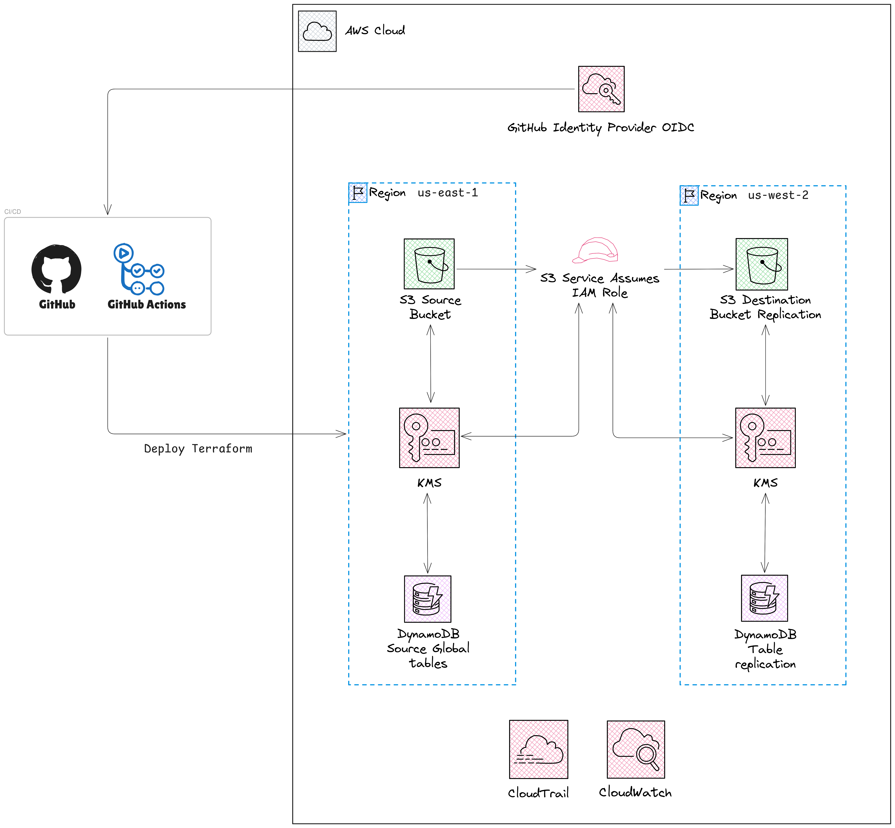

# Remote Terraform Backend on AWS

Production-ready Terraform remote state management on AWS, provisioned entirely with Terraform. It treats security as a
first-class concern and provides team collaboration, state locking, auditing, and cross-region disaster recovery.
Deployment is automated through GitHub Actions using keyless OIDC authentication.

## Overview

**Terraform state** is the source of truth for your infrastructure. By default it lives in a local `terraform.tfstate`
file, which is fine for learning but fails for teams. This project replaces it with a hardened remote backend.

### Why local state fails

| Risk              | Local state                                                                                                         | Remote state (this project)                                                           |
|-------------------|---------------------------------------------------------------------------------------------------------------------|---------------------------------------------------------------------------------------|
| **Security**      | State holds secrets (credentials, keys, connection strings) in plaintext and is easily committed to Git by accident | KMS encryption at rest, HTTPS-only access, public access blocked, least-privilege IAM |
| **Collaboration** | No single source of truth; engineers overwrite each other's changes                                                 | One shared state in S3                                                                |
| **Concurrency**   | Concurrent applies corrupt state                                                                                    | DynamoDB state locking                                                                |
| **Resilience**    | A laptop crash or corrupted file orphans deployed resources; no protection against regional outages                 | S3 versioning, cross-region replication, DynamoDB Global Tables                       |
| **Compliance**    | No audit trail of who changed what, and when                                                                        | CloudTrail + CloudWatch audit logging and alarms                                      |

### Design goals

- **State locking:** a distributed lock (DynamoDB) blocks simultaneous runs from team members and CI/CD pipelines.
- **Zero-trust CI/CD:** no long-lived AWS keys; GitHub Actions authenticates with OpenID Connect (OIDC) and short-lived
  JWTs.
- **Defense in depth:** customer-managed KMS encryption at rest, HTTPS enforced in transit, all public S3 access
  blocked, strict IAM policies.
- **Multi-region resilience:** S3 cross-region replication (CRR) and DynamoDB Global Tables between `us-east-1`
  (primary) and `us-west-2` (secondary) for failover without state loss or locking failures.
- **Observability:** CloudTrail captures S3 and DynamoDB data events, streams them to CloudWatch Logs, and CloudWatch
  alarms flag stale backups, long-held locks, and unauthorized access.

### Learning objectives

- Local vs. remote state management
- Creating and configuring the backend infrastructure
- State locking with DynamoDB
- Securing, monitoring, and auditing state
- Automated backup and recovery strategy
- Migrating from local to remote state

## Architecture



### Components

| Component                           | Role                                                                                                            |
|-------------------------------------|-----------------------------------------------------------------------------------------------------------------|
| **GitHub / GitHub Actions**         | Hosts the Terraform code and triggers deployments.                                                              |
| **GitHub OIDC identity provider**   | Lets GitHub Actions authenticate to AWS with a short-lived JWT instead of static credentials stored as secrets. |
| **S3 state bucket** (`us-east-1`)   | Stores `terraform.tfstate` with versioning, giving shared access and state history.                             |
| **S3 replica bucket** (`us-west-2`) | Receives cross-region replication of the state bucket. The IAM replication role is assumed by the S3 service.   |
| **DynamoDB lock table**             | Prevents two Terraform runs from modifying state simultaneously. Replicated to `us-west-2` as a Global Table.   |
| **KMS keys** (one per region)       | Encrypt the S3 buckets and DynamoDB tables.                                                                     |
| **CloudTrail / CloudWatch**         | Audit logging and alarms.                                                                                       |
| **SNS**                             | Notification channel for alerts and S3 events.                                                                  |

### Deployment flow

1. A push or pull request triggers a GitHub Actions workflow.
2. The runner requests an OIDC token from GitHub.
3. AWS validates the token against the registered GitHub identity provider.
4. The runner assumes an IAM role; no static credentials are involved.
5. Terraform reads and writes state in the S3 backend.
6. DynamoDB locks the state for the duration of the operation.

### Why this pattern

This is the recommended approach for running Terraform in a team/CI environment on AWS:

- **No static credentials:** OIDC tokens are short-lived and scoped.
- **Shared state:** S3 enables team collaboration.
- **Safe concurrency:** DynamoDB locking prevents corruption.
- **Auditability:** S3 versioning and CloudTrail preserve history.

## Prerequisites

**Tooling**

- AWS account and AWS CLI, installed and configured
- Terraform >= 1.0

**GitHub / AWS integration**

1. Create an OpenID Connect identity provider in IAM with a trust relationship to this GitHub repository.
2. Store the ARN of the resulting IAM role as a GitHub secret named `AWS_ROLE_ARN` (referenced by the workflow files).

**AWS permissions** required by the deploying user/role:

| Service                            | Access                       |
|------------------------------------|------------------------------|
| S3, DynamoDB, KMS, SNS, CloudTrail | Full access                  |
| CloudWatch                         | Dashboard and metrics access |

## Project Structure

```
remote-backend-setup/
├── modules/
│   ├── cloudtrail/              # Audit logging infrastructure
│   │   ├── main.tf
│   │   ├── outputs.tf
│   │   └── variables.tf
│   ├── cloudwatch/              # Monitoring and alerting
│   │   ├── main.tf
│   │   ├── outputs.tf
│   │   └── variables.tf
│   ├── dynamodb/                # State-locking table (prevents concurrent runs)
│   │   ├── main.tf
│   │   ├── outputs.tf
│   │   └── variables.tf
│   ├── iam/
│   │   ├── bucket_policy.tf     # Secure S3 bucket policy for state files
│   │   ├── github_actions.tf    # GitHub Actions <-> AWS integration via OIDC
│   │   ├── iam_cloudtrail.tf    # CloudTrail permissions and S3 log storage
│   │   ├── iam_replication.tf   # Permissions for S3 cross-region replication
│   │   ├── outputs.tf
│   │   └── variables.tf
│   ├── kms/                     # KMS encryption keys
│   │   ├── main.tf
│   │   ├── outputs.tf
│   │   └── variables.tf
│   ├── s3/                      # Secure S3 backend for state files
│   │   ├── outputs.tf
│   │   ├── replication.tf
│   │   ├── s3-state-file.tf
│   │   └── variables.tf
│   └── sns/                     # Notification system
│       ├── main.tf
│       ├── outputs.tf
│       └── variables.tf
├── .github/workflows/
│   ├── backend-deployment.yml   # Deploys the backend (OIDC)
│   ├── drift-detection.yml      # Scheduled drift detection
│   ├── terraform-checkov.yml    # Checkov security scan
│   ├── terraform-infracost.yml  # Cost estimation
│   ├── terraform-tflint.yml     # TFLint linting
│   ├── terrascan.yml            # Terrascan security scan
│   └── tfsec-scanner.yml        # tfsec security scan
├── backend.tf                   # Backend configuration
├── data.tf                      # Data sources
├── locals.tf                    # Common tags
├── main.tf                      # Main infrastructure resources
├── outputs.tf                   # Output values
├── providers.tf                 # Terraform and AWS provider configuration
├── variables.tf                 # Input variables and defaults
├── dev-terraform.tfvars         # Dev environment values
├── staging-terraform.tfvars     # Staging environment values
└── prod-terraform.tfvars        # Prod environment values
```

## What Gets Deployed

### S3 state bucket

- Deletion protection against accidental removal
- Versioning to keep state history
- KMS encryption
- All public access blocked (**critical**)
- Access logging
- Lifecycle policy for cost optimization
- Event notifications to SNS (`ObjectCreated`, `ObjectRemoved`)
- Cross-region replication of encrypted objects for disaster recovery

### DynamoDB lock table

- Encryption at rest
- Deletion protection
- Global Table replication to the DR region

### Security

- IAM policies restricting state read/write access
- KMS keys for state encryption
- Bucket policy enforcing encryption in transit (HTTPS only)

### Notifications and auditing

- **SNS topic** for Terraform state notifications and alerts
- **CloudTrail** trail dedicated to Terraform state, with:
    - a separate S3 log bucket with its own retention policy
    - data events for the state bucket and DynamoDB lock operations
    - delivery to CloudWatch Logs for centralized querying
- **CloudWatch** log group and alarms (see [Auditing and Monitoring](#auditing-and-monitoring))

## Deployment

1. Complete the [prerequisites](#prerequisites).
2. Review the `*-terraform.tfvars` file for your target environment.
3. Deploy, either through the `backend-deployment.yml` workflow or manually:

   ```bash
   terraform init
   terraform plan  -var-file="dev-terraform.tfvars"
   terraform apply -var-file="dev-terraform.tfvars"
   ```

4. Configure the remote backend in `backend.tf` and [migrate the state](#migrating-from-local-to-remote-state).

### Outputs

| Output                         | Description                                      |
|--------------------------------|--------------------------------------------------|
| `terraform_execution_role_arn` | Terraform execution role ARN for GitHub Actions  |
| `backend_config`               | Backend configuration to reuse in other projects |

## CI/CD Workflows

| Workflow                  | Purpose                                                                             |
|---------------------------|-------------------------------------------------------------------------------------|
| `backend-deployment.yml`  | Deploys the remote state backend using OIDC.                                        |
| `terraform-checkov.yml`   | Checkov scans for Terraform misconfigurations at repository and PR level.           |
| `tfsec-scanner.yml`       | tfsec catches security misconfigurations before they reach AWS.                     |
| `terrascan.yml`           | Terrascan scans for security vulnerabilities.                                       |
| `terraform-tflint.yml`    | TFLint reports stylistic, security, and provider-specific issues before deployment. |
| `terraform-infracost.yml` | Estimates infrastructure cost before deploying.                                     |
| `drift-detection.yml`     | Scheduled run that detects unauthorized changes early and alerts the team.          |

## Migrating from Local to Remote State

1. **Create the backend infrastructure**

   ```bash
   terraform init
   terraform plan
   terraform apply
   ```

2. **Save the outputs**

   ```bash
   terraform output -json > backend-config.json
   terraform output backend_config > backend-template.tf
   ```

3. **Back up the local state**

   ```bash
   cp terraform.tfstate terraform.tfstate.backup
   aws s3 cp terraform.tfstate s3://<state-bucket>/bootstrap/terraform.tfstate
   ```

4. **Activate the backend configuration** in `backend.tf`.
5. **Migrate the state**

   ```bash
   terraform init -migrate-state
   ```

6. **Verify**

   ```bash
   terraform state list        # resources are present
   terraform show              # backend is configured
   aws s3 ls s3://<state-bucket>/<env>/infrastructure/   # terraform.tfstate exists
   terraform plan              # runs normally, pulling state from S3
   ```

7. **Remove local state** (only after verification):

   ```bash
   rm terraform.tfstate terraform.tfstate.backup
   ```

## Operations

### State management commands

| Task                                 | Command                                                |
|--------------------------------------|--------------------------------------------------------|
| List all resources in state          | `terraform state list`                                 |
| Show a specific resource             | `terraform state show aws_instance.web`                |
| Pull remote state for inspection     | `terraform state pull > state.json`                    |
| Rename a resource in state           | `terraform state mv aws_instance.old aws_instance.new` |
| Remove from state without destroying | `terraform state rm aws_instance.web`                  |

### Why state access must be restricted

State files contain data you do not want exposed:

- Resource IDs and ARNs that map your infrastructure
- Database passwords and connection strings
- Private keys (e.g. from `tls_private_key`)
- API keys passed in through variables
- Output values, including those marked sensitive

## Auditing and Monitoring

When something goes wrong, the first question is "what changed?" An audit trail is critical for compliance, production
debugging, and security monitoring. Every state change should answer:

| Question | Examples                                       |
|----------|------------------------------------------------|
| **Who**  | User identity, CI/CD pipeline, service account |
| **When** | Timestamp                                      |
| **What** | Resources added, modified, or removed          |
| **How**  | Manual apply, CI/CD pipeline, state push       |
| **Why**  | Linked PR, ticket, or change request           |

### CloudWatch alarms

- Terraform state locks held too long
- Unusual or unauthorized state access (including more than 5 accesses within 5 minutes)
- State file modified or accessed
- State backups stale
- Replication failing or lagging
- Multiple failed OIDC authentication attempts

## Disaster Recovery

Without a recovery strategy for state:

- Terraform cannot tell what to create, update, or destroy; `terraform plan` shows every resource as new.
- Orphaned resources require manual cleanup, and sensitive outputs and attributes are lost.
- A regional outage makes state inaccessible, blocking `plan` and `apply`.
- Accidental deletion, or corruption from a failed migration or race condition, blocks all operations.
- A compromised storage account could allow state tampering.

Mitigations are listed under [Best Practices](#best-practices).

## Best Practices

**Security**

- Encrypt state at rest with KMS.
- Restrict read/write access with IAM policies.
- Block all public access; never expose state publicly.
- Enable CloudTrail logging for S3 and DynamoDB.

**Durability and backup**

- Enable versioning on the backend bucket. This is the bare minimum for production and the first defense against
  deletion and corruption.
- Keep backups for at least 30 days; some issues take time to surface.
- Never store backups in the same location as the primary state.
- Test your restore process periodically. An untested backup cannot be trusted.

**Disaster recovery**

- Set up cross-region replication for critical state.
- Replicate lock tables too (DynamoDB Global Tables) so locking works during failover.
- Keep backend configs for both regions ready so failover is a single command.
- Run failover drills weekly or monthly.
- Document the failover procedure and store it somewhere reachable during an outage (not only in the primary region).

**Monitoring**

- Alarm on the state file and lock table with CloudWatch.
- Monitor backup freshness and replication lag; stale replicas mean data loss during failover.

## Verification

After deployment, confirm the resources in the AWS Management Console. Reference screenshots are in the `Verification/`
directory.

| Area       | Screenshot                                             | Shows                                 |
|------------|--------------------------------------------------------|---------------------------------------|
| Backend    | `0-backend output.png`                                 | Backend config and execution role ARN |
| Migration  | `1-terraform init -migrate-state.png`                  | State migration re-initialization     |
|            | `2-1-terraform-state migrated.png`                     | State migrated                        |
| S3         | `2-s3 bucket.png`                                      | Buckets created                       |
|            | `3-s3 tf state.png`                                    | State bucket properties               |
|            | `4-s3 tf state replica.png`                            | Replica bucket properties             |
|            | `5-terraform-state-data-replica.png`                   | State replicated in `us-west-2`       |
| DynamoDB   | `6-dynamodb table us-east-1.png`                       | Primary-region table                  |
|            | `7-table: ce-dev-terraform-locks - Items returned.png` | Lock table items                      |
|            | `8-dynamodb table in us-west-2.png`                    | Secondary-region table                |
|            | `9-dynamodb Global tables.png`                         | Global table replicas                 |
| KMS        | `10-KMS key.png`                                       | Primary-region key                    |
|            | `11-KMS key replica.png`                               | Secondary-region key                  |
|            | `12-KMS key rotation.png`                              | Key rotation period                   |
| SNS        | `13-sns topic.png`                                     | Topic created                         |
|            | `14-sns all subscription.png`                          | Subscriptions created                 |
| CloudTrail | `15-s3-cloudtrail.png`                                 | CloudTrail log bucket                 |
|            | `16-cloudtrail.png`                                    | Trail for the state file              |
| CloudWatch | `17-cloudwatch log groups.png`                         | Log groups for CloudTrail             |
|            | `18-Log groups ce-dev-terraform-state-file-trail.png`  | Log group details                     |
|            | `19-cloudwatch Alarms.png`                             | Alarms created                        |

## Cleanup

To delete everything created by this project:

```bash
terraform destroy -var-file="dev-terraform.tfvars" -auto-approve
```

> **Important:** Review and test this configuration in a non-production environment first, and customize S3, DynamoDB,
> replication, and other settings to your organization's requirements. Destroying the backend deletes the state it
> protects, so migrate state elsewhere first if you still need it.
